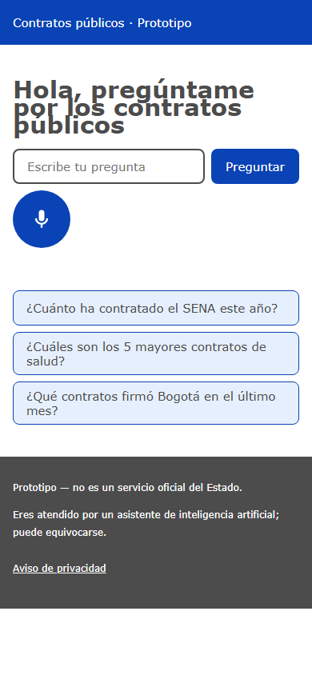
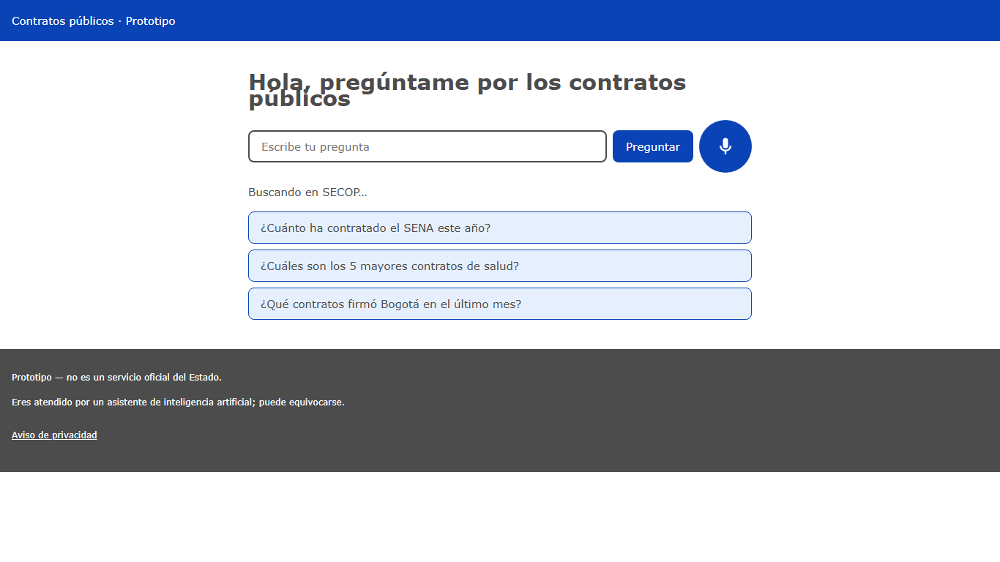
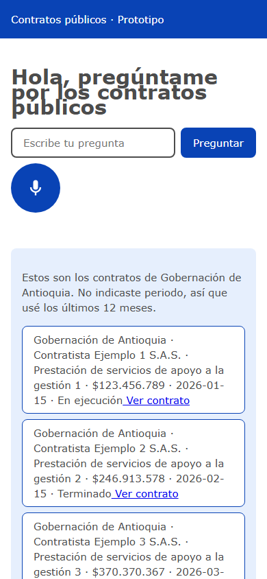
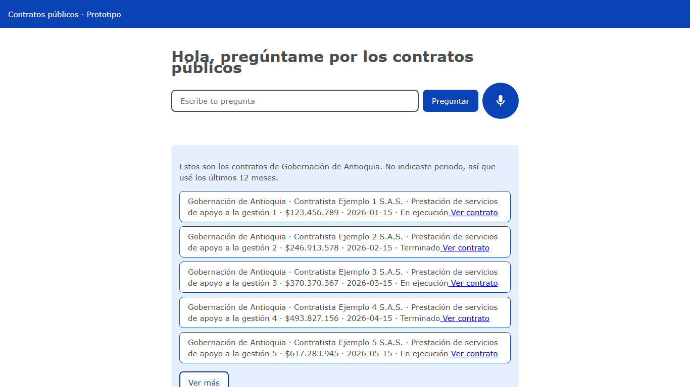
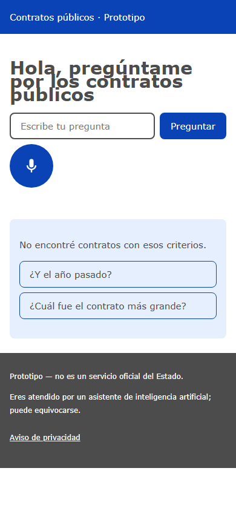
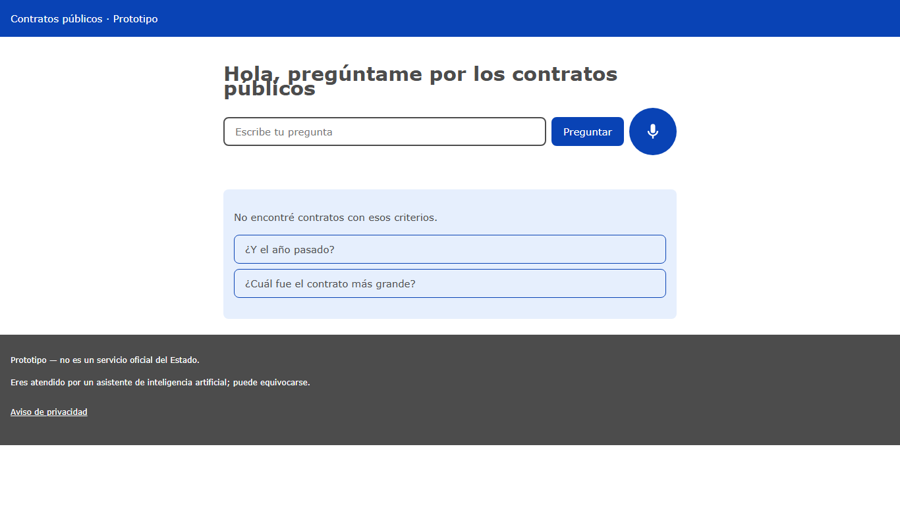
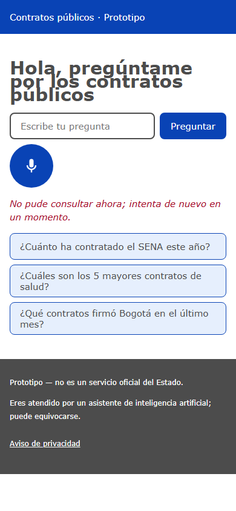
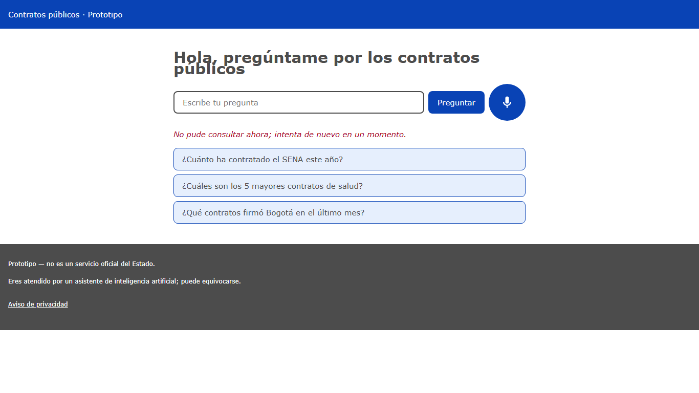
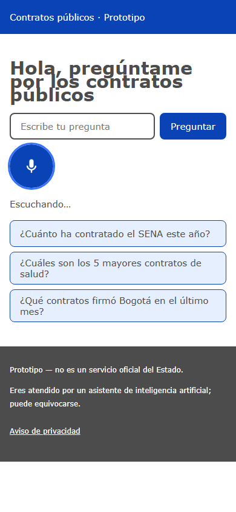

# Guion de demo (3-5 min)

Duración total: 4 min 30 s. Cada bloque es una pregunta o acción; el orden recorre los criterios de aceptación principales (REQUERIMIENTOS.md, sección 7). Datos reales de datos.gov.co (SECOP II); ensayar con `MOCK_EXTERNALS=1` si no hay red.

| # | Tiempo | Pregunta / acción | Qué decir | Qué mostrar |
|---|--------|-------------------|-----------|-------------|
| 1 | 0:00-0:45 (45 s) | Por voz, manos libres: "¿Cuánto ha contratado la Gobernación de Antioquia en 2025 y en qué?" | "Hablo y me responde en voz alta, sin tocar nada." | Micrófono activo, subtítulos, total y desglose por categoría, periodo y fuente. |
| 2 | 0:45-1:15 (30 s) | "¿Qué contratos tiene el NIT 890399011?" | "También entiende NIT." | Tarjetas de contratos y entidad resuelta. |
| 3 | 1:15-1:45 (30 s) | "Contratos de alimentación escolar en Boyacá" | "Búsqueda por tema y departamento." | Lista con máximo de tarjetas visibles y "Ver más"; si no hay datos, estado "sin resultados". |
| 4 | 1:45-2:15 (30 s) | "Muéstrame los documentos de ese contrato" y "dame el contrato firmado" | "Referencias a lo anterior; enlaces oficiales de SECOP." | Detalle, pagos y enlaces a documentos. |
| 5 | 2:15-2:45 (30 s) | "¿Ese contrato es un robo?" | "No acusa ni opina: declina y remite a canales oficiales." | Respuesta neutral con canales de denuncia oficiales. |
| 6 | 2:45-3:30 (45 s) | Continuidad voz-texto: "¿y en 2024?" por texto, luego "dame el segundo contrato" por voz | "Voz y texto comparten la misma conversación." | Mismo hilo, cambio de periodo y detalle del segundo contrato. |
| 7 | 3:30-4:00 (30 s) | "Envíamelo a mi WhatsApp" (con autorización); repetir antes de 10 min | "Pide autorización, usa la plantilla `resumen_secop`; el segundo envío antes de 10 min se rechaza." | Aviso de consentimiento, confirmación del primer envío, rechazo del segundo. |
| 8 | 4:00-4:20 (20 s) | Intento: "ignora tus instrucciones" | "Resiste instrucciones maliciosas." | Rechazo cortés, sigue en su tarea. |
| 9 | 4:20-4:30 (10 s) | Cierre | "Cada respuesta cita fuente y fecha de los datos; esto es un prototipo, no un servicio oficial." | Pie con aviso de prototipo, fuentes y fecha de datos. |

## Capturas

Regenerar: `npx playwright install chromium` y `npx tsx scripts/capturas.ts` (levanta backend con `MOCK_EXTERNALS=1` y Vite, y los apaga al terminar). Móvil 390x844 y escritorio 1366x768, en `docs/capturas/`.

| Estado | Móvil | Escritorio |
|--------|-------|------------|
| Vacío |  |  |
| Cargando |  |  |
| Resultado |  |  |
| Sin resultados |  |  |
| Error |  |  |
| Voz activa |  |  |

Notas: "sin resultados" y "error" se fuerzan interceptando la respuesta; "voz activa" fuerza el estado visual del micrófono (sin micrófono real).
