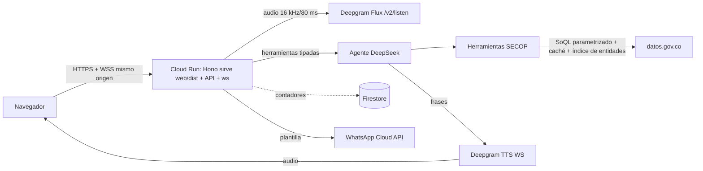

# Desplegar en GCP un agente de IA por chat y voz que informa sobre contratación pública (SECOP) con datos oficiales

| Campo | Valor |
|---|---|
| Entregable | app (frontend + backend + voz) |
| Punto de partida | desde cero |
| Fecha límite | 2026-10-16 20:18 (-05:00) — hoy + 10 h |
| Idioma | español de Colombia |
| Datos y ley | públicos (SECOP) + personales de ciudadanos (preguntas, número de WhatsApp) — Ley 1581 de 2012, Res. MinTIC 1519/2020 — ASVS L2 |
| Plataforma | GCP: Cloud Run (un solo servicio sirve frontend estático y API, min-instances=0; cambio 003) + Firestore (solo contadores) |
| Confidencialidad | el código puede enviarse a Claude: sí — autorizado por el dueño del producto (repo público) |
| Aprobador | dueño del producto (Daniel) |

## Objetivos

- O-1: Cuando un ciudadano pregunta por contratos o gasto público, quiere cifras y documentos verificables para confiar en lo que ve — medida: 100 % de las cifras mostradas coinciden con el resultado de la consulta a datos.gov.co (verificable en log).
- O-2: Cuando un usuario pide opinión, política o algo fuera de tema, el agente debe declinar y redirigir — medida: 16/16 límites NO-01..16 con al menos una pregunta de prueba que declina correctamente.
- O-3: Cuando el usuario escribe o habla, quiere respuesta inmediata — medida: primer token de texto < 1 s y primera palabra hablada < 1 s en p95 tras fin de turno (meta p50 ~500 ms), arranque en frío medido aparte.
- O-4: Como dueño del producto quiero costo mínimo — medida: tokens de LLM por pregunta registrados y reportados (sin tope fijo por pregunta; cambio 001), pregunta repetida = 0 tokens, costo en reposo ≈ $0 (0 instancias activas sin tráfico), alerta de presupuesto activa.
- O-5: Cuando un ciudadano sin conocimiento técnico usa el servicio, quiere completar tareas sin instrucciones — medida: 3–5 personas completan "consultar contratos de una entidad" y "abrir un documento", por texto y voz, sin ayuda.
- O-6: Como candidato a servicio del Estado quiero verme y cumplir como GOV.CO — medida: 0 errores WCAG 2.1 AA en auditoría automática, `DESIGN.md` con fuente por regla, aviso de prototipo visible.
- O-7: Como dueño del producto quiero la demo en la nube — medida: URL pública HTTPS en proyecto GCP nuevo y dedicado, chat y voz funcionando desde un móvil.

## Prioridades de calidad

1. Veracidad y neutralidad — el agente solo informa; una cifra inventada o un juicio destruyen la confianza.
2. Velocidad — todo > 1 s es defecto; la arquitectura se decide primero por latencia.
3. Seguridad y costo — credenciales nunca al navegador; nadie puede agotar créditos de DeepSeek/Deepgram.
4. Simplicidad de uso y diseño GOV.CO.

## Historias y criterios

Budget exceeded: AC — los criterios compuestos del cliente se partieron en criterios de una sola respuesta verificable y se añadieron los P0 que faltaban (US-01, US-02, US-04, US-05, US-08, US-09 pasan de 6 criterios).

Budget exceeded: US — el cambio 006 agrega US-13 (13 historias).

Budget exceeded: T — la tarea T022 del cambio 005 (conversación natural) cruza US-01, US-05 y US-06; por eso US-01 cuenta 4 tareas.

Valores por defecto (variables de entorno, ajustables sin cambiar código): 20 peticiones/min por IP, 500 caracteres por mensaje, 30 turnos por conversación, 60 s por enunciado de audio, 10 min por sesión de voz, 3 herramientas por turno, tope diario de 1.000.000 de tokens de LLM y 120 min de voz, caducidad del estado firmado 2 h.

### US-01 Consultar contratos, gasto y avance (Must)
Como ciudadano quiero preguntar en lenguaje natural por contratos, gasto y fuentes de recursos de una entidad, contratista o tema para ver datos oficiales con enlace.
serves: O-1, O-3
risk: high — integración externa con datos.gov.co y datos personales públicos de contratistas

- **AC-01.1** WHEN el usuario pregunta por contratos de una entidad, municipio, departamento, contratista (nombre o NIT) o tema THE SYSTEM SHALL mostrar entidad, contratista, objeto, valor, fecha de firma, estado y enlace SECOP, con máximo 5 visibles y "ver más" (RF-01).
  serves: US-01
- **AC-01.2** WHEN el usuario pregunta en qué se gasta una entidad o territorio THE SYSTEM SHALL mostrar totales por categoría (tipo de contrato, sector o modalidad) y número de contratos (RF-02).
  serves: US-01
- **AC-01.3** WHEN el usuario pregunta de dónde sale el dinero THE SYSTEM SHALL mostrar el desglose por fuente de recursos disponible (RF-03).
  serves: US-01
- **AC-01.4** WHEN el usuario pregunta por los contratos más grandes o los contratistas que más reciben THE SYSTEM SHALL mostrar un top 10 ordenado por valor (RF-04).
  serves: US-01
- **AC-01.5** WHEN el usuario pide el detalle, avance o pagos de un contrato THE SYSTEM SHALL mostrar ficha completa, enlace oficial, valor, facturado, pagado, pendiente, días adicionados y adiciones/modificaciones (RF-05, RF-06).
  serves: US-01
- **AC-01.6** IF la entidad es ambigua THEN THE SYSTEM SHALL mostrar opciones tocables; IF no hay resultados THEN THE SYSTEM SHALL decirlo y sugerir ampliar el periodo o revisar el nombre sin inventar datos (RF-07, RF-08).
  serves: US-01
- **AC-01.7** IF el usuario no indica periodo THEN THE SYSTEM SHALL usar los últimos 12 meses y decirlo (RF-09).
  serves: US-01
- **AC-01.8** THE SYSTEM SHALL generar cada cifra mostrada o hablada solo a partir del resultado de la consulta (tarjetas desde datos estructurados) y descartar del texto del LLM cualquier número que no esté en esos resultados (RNF-01).
  serves: US-01
- **AC-01.9** IF datos.gov.co responde lento o falla THEN THE SYSTEM SHALL hacer 1 reintento con tope de 6,5 s de API y, si sigue fallando, responder desde la copia comprimida de agregados y contratos recientes del contenedor o la caché, avisando la fecha de los datos; si no hay respaldo, decir en una frase qué pasó y qué hacer, nunca "la búsqueda falló" a secas (RNF-08; cambio 006).
  serves: US-01
- **AC-01.10** THE SYSTEM SHALL incluir en cada respuesta el dataset fuente, la fecha de consulta, la fecha hasta la que están actualizados los datos y un enlace oficial; la tarjeta muestra el valor exacto en pesos con "COP" (`$1.234.567.890 COP`) (RF-17, RF-23, RNF-06; cambio 006).
  serves: US-01
- **AC-01.11** THE SYSTEM SHALL construir toda consulta SoQL en el servidor desde parámetros tipados con lista permitida de columnas y operadores, valores escapados, `$limit` ≤ 100 y `$where` acotado, de modo que ninguna entrada del usuario o del modelo llegue como SoQL crudo.
  serves: US-01
- **AC-01.12** THE SYSTEM SHALL redactar la respuesta de texto en lenguaje llano con la cifra clave redondeada en pesos ("$2.700 millones de pesos") y nombres en formato normal (no en mayúsculas crudas); el valor exacto queda en la tarjeta (cambios 005 y 006).
  serves: US-01

### US-02 Ver y abrir documentos del contrato (Must)
Como ciudadano o periodista quiero la lista de documentos oficiales de un contrato y abrirlos para verificar por mi cuenta.
serves: O-1
risk: high — integración externa y nombres de archivo con cédulas y nombres de personas naturales

- **AC-02.1** WHEN el usuario consulta un contrato o proceso THE SYSTEM SHALL listar sus documentos sin duplicados (nombre, tipo, tamaño, fecha de carga, enlace oficial), consultando el dataset de archivos que corresponda al año (`dmgg-8hin`, históricos, SECOP I) (RF-11).
  serves: US-02
- **AC-02.2** WHEN el usuario pide un documento específico ("el contrato firmado", "el estudio previo") THE SYSTEM SHALL entregar el enlace oficial de ese documento (RF-12).
  serves: US-02
- **AC-02.3** IF el documento no está publicado o no se encuentra THEN THE SYSTEM SHALL decirlo y dar el enlace al proceso en SECOP (RF-13).
  serves: US-02
- **AC-02.4** THE SYSTEM SHALL mostrar los nombres de archivo sin números de documento ni nombres de personas naturales, y nunca descargar ni retransmitir el archivo (NO-06, NO-14, RNF-04).
  serves: US-02
- **AC-02.5** THE SYSTEM SHALL emitir como enlace solo URLs `https://` cuyo host sea `community.secop.gov.co` o `*.secop.gov.co`, con `rel="noopener noreferrer"`, y descartar cualquier otro esquema o host que venga en los datos.
  serves: US-02

### US-03 Neutralidad y límites del agente (Must)
Como dueño del producto quiero que el agente solo informe y declina todo lo demás para que nunca opine, acuse ni sea manipulado.
serves: O-2
risk: high — seguridad: inyección de prompt y manipulación del agente

- **AC-03.1** WHEN el usuario pide opinión, juicio, acusación o predicción (NO-01..03) o habla de política (NO-04..05) THE SYSTEM SHALL declinar en una frase, ofrecer datos comparables y los canales oficiales (Contraloría, Procuraduría, Fiscalía, Colombia Compra Eficiente), sin calificativos (RF-15, RF-16).
  serves: US-03
- **AC-03.2** WHEN el usuario pide datos personales, perfiles, asesoría jurídica o contable, redactar denuncias, temas fuera de contratación o fuentes no oficiales (NO-06..11) THE SYSTEM SHALL declinar y redirigir a lo que sí puede hacer.
  serves: US-03
- **AC-03.3** IF el usuario o el texto de un contrato o documento intenta cambiar el rol, revelar instrucciones o claves, ejecutar acciones, generar contenido ofensivo o hacerse pasar por entidad oficial (NO-12..16) THEN THE SYSTEM SHALL ignorar la orden y declinar, y el texto de SECOP se entrega al modelo como dato delimitado, nunca como instrucción (RNF-05).
  serves: US-03
- **AC-03.4** THE SYSTEM SHALL incluir `eval/limits.json` con al menos una pregunta por cada NO-01..NO-16 más intentos de "ignora tus instrucciones" y objetos de contrato con órdenes inyectadas; se considera que declinó cuando el agente llama a la herramienta `decline(código NO-xx)` y la respuesta sale de plantillas fijas sin cifras ni calificativos. `npm run eval` contra DeepSeek real debe dar 100 % y es condición de verificación (el modo simulado solo prueba el arnés).
  serves: US-03

### US-04 Interfaz simple estilo GOV.CO (Must)
Como ciudadano sin conocimiento técnico quiero una pantalla clara con una sola acción principal para preguntar sin sentirme perdido.
serves: O-5, O-6
risk: low — presentación; privacidad y seguridad se cubren en US-07 y US-08

- **AC-04.1** WHEN el usuario abre la página THE SYSTEM SHALL mostrar saludo, campo de pregunta con botón de micrófono, 3–4 preguntas de ejemplo tocables, el aviso "Prototipo — no es un servicio oficial del Estado" y el aviso de asistente de IA, y nada más (DIS-04, DIS-06, DIS-08).
  serves: US-04
- **AC-04.2** THE SYSTEM SHALL responder en capas: respuesta corta con cifra clave primero, y tabla, lista, documentos y fuentes a demanda, con tarjetas legibles en móvil y 2–3 sugerencias de siguiente pregunta tocables (DIS-08).
  serves: US-04
- **AC-04.3** THE SYSTEM SHALL mostrar el estado del agente (escuchando, buscando en SECOP, respondiendo) y, ante error, sin datos o voz caída, un mensaje de una frase que dice qué pasó y qué hacer (RF-20, DIS-06).
  serves: US-04
- **AC-04.4** THE SYSTEM SHALL reaccionar a toda acción de la UI en menos de 100 ms, con diseño móvil primero y objetivos táctiles ≥ 44 px (RNF-02).
  serves: US-04
- **AC-04.5** THE SYSTEM SHALL pasar una auditoría automática axe con 0 errores WCAG 2.1 A/AA en móvil y escritorio, en los estados vacío, cargando, resultado, sin resultados, error y voz activa (DIS-05, DIS-07).
  serves: US-04
- **AC-04.6** THE SYSTEM SHALL usar la paleta, la tipografía (Verdana), el encabezado, el pie y los componentes del Kit UI GOV.CO según `docs/DESIGN.md`, sin logos ni sellos oficiales hasta la adopción (DIS-01, DIS-03, DIS-04).
  serves: US-04
- **AC-04.7** THE SYSTEM SHALL ofrecer un solo control de micrófono grande con estados inequívocos (escuchando, procesando, hablando, en pausa), indicador del nivel de voz, subtítulos en vivo del usuario y del agente, y un botón evidente para silenciar o interrumpir al agente (DIS-09).
  serves: US-04

### US-05 Conversación por voz manos libres (Must)
Como ciudadano quiero hablar con el agente y oírlo responder sin pulsar "enviar" para consultar sin escribir.
serves: O-3, O-5
risk: high — integración externa pagada (Deepgram) con audio de ciudadanos

- **AC-05.1** WHEN el usuario deja de hablar THE SYSTEM SHALL detectar el fin de turno con el Voice Agent de Deepgram (`wss://agent.deepgram.com/v1/agent/converse`, listen nova-3 en español con keyterms) y responder en voz sin más pasos (RF-19e; cambio 006).
  serves: US-05
- **AC-05.2** THE SYSTEM SHALL responder en voz por el Voice Agent (think = DeepSeek `deepseek-flash` por endpoint compatible con OpenAI, temperatura 0,2; speak = `aura-2-celeste-es`) y mostrar el mismo contenido en pantalla a partir de `ConversationText` (RF-19; cambio 006).
  serves: US-05
- **AC-05.3** WHEN el usuario habla encima del agente THE SYSTEM SHALL vaciar el audio en cola al recibir `UserStartedSpeaking` y escuchar (RF-19e; cambio 006).
  serves: US-05
- **AC-05.4** THE SYSTEM SHALL no decir frases de relleno ni acuses ("Claro, déjame buscar eso"); mientras busca solo muestra el estado visual "Buscando en SECOP…" (cambio 005; retira el acuse de RF-19e por decisión del dueño).
  serves: US-05
- **AC-05.5** IF la sesión de voz se corta THEN THE SYSTEM SHALL mantener el micrófono continuo y el KeepAlive del protocolo del agente, reintentar la sesión y solo avisar que la voz no está disponible si no se recupera; el chat por texto sigue funcionando (RF-19b; cambio 006).
  serves: US-05
- **AC-05.6** THE SYSTEM SHALL medir fin de turno → primera palabra del Voice Agent (fin de turno, herramienta, primer audio) con objetivo p95 < 1 s y meta p50 ≈ 500 ms, y documentar fuentes y decisiones en `docs/VOZ.md` (RNF-02b, RF-19g; cambio 006).
  serves: US-05
- **AC-05.7** THE SYSTEM SHALL no guardar audio ni transcripciones en disco ni en logs (RNF-16).
  serves: US-05
- **AC-05.8** IF se supera el tope diario de minutos de voz o los 10 min de una sesión THEN THE SYSTEM SHALL pasar a texto con aviso claro.
  serves: US-05
- **AC-05.9** THE SYSTEM SHALL hablar las cifras en español natural de Colombia ("27 mil millones de pesos"), las fechas de forma natural ("15 de marzo de 2026"), sin códigos, identificadores, siglas crudas ni nombres en mayúsculas, en máximo 2 frases (RNF-06; cambio 005).
  serves: US-05

### US-06 Una sola conversación voz + texto (Must)
Como ciudadano quiero seguir mi conversación entre voz y texto sin repetir nada.
serves: O-5
risk: high — el estado de la conversación vive en el navegador, es firmado y contiene preguntas de ciudadanos (datos personales, RNF-16)

- **AC-06.1** WHEN el usuario hace una pregunta de seguimiento ("¿y en 2024?", "el segundo", "ese contrato", "el más grande", "ábrelo") THE SYSTEM SHALL resolverla con el contexto acumulado: en voz, con el historial de la sesión del Voice Agent, donde también entra lo escrito o tocado mientras la voz está activa (`InjectUserMessage`); en solo texto, con el contexto firmado y los resultados mostrados (RF-10, RF-19f; cambios 005 y 006).
  serves: US-06
- **AC-06.2** WHEN el usuario recarga la página o reconecta la voz THE SYSTEM SHALL recuperar el contexto desde un estado firmado por el servidor (HMAC, versión de clave, caducidad 2 h).
  serves: US-06
- **AC-06.3** IF la firma no es válida, la versión de clave es vieja o el estado expiró THEN THE SYSTEM SHALL empezar una conversación nueva sin error visible.
  serves: US-06
- **AC-06.4** IF el usuario cambia de tema THEN THE SYSTEM SHALL dejar de arrastrar la entidad y el periodo anteriores.
  serves: US-06

### US-07 Privacidad y protección de datos (Must)
Como ciudadano quiero que no se muestren ni guarden mis datos ni los de personas naturales para estar protegido.
serves: O-1, O-6
risk: high — datos personales (Ley 1581 de 2012) y datos bancarios en el dataset fuente

- **AC-07.1** THE SYSTEM SHALL consultar solo columnas de una lista permitida, nunca banco, tipo o número de cuenta ni números de documento de personas naturales (RNF-04).
  serves: US-07
- **AC-07.2** THE SYSTEM SHALL depurar de respuestas y nombres de archivo los números de documento de personas naturales (tipo CC/CE o contratista persona natural) y conservar los NIT de entidades y empresas: la pregunta "¿Qué contratos tiene el NIT 890399011?" sigue funcionando.
  serves: US-07
- **AC-07.3** WHEN el usuario entra por primera vez, o antes de pedir su número de WhatsApp, THE SYSTEM SHALL mostrar un aviso de privacidad corto (qué se guarda, para qué, por cuánto tiempo, derechos) y registrar la aceptación (RNF-16).
  serves: US-07
- **AC-07.4** THE SYSTEM SHALL registrar por turno solo tokens, latencia, canal, código de error, intención, ruta (atajo, agente, respaldo), herramientas llamadas, código de declinación y motivo de cierre de la voz, sin texto de pregunta ni respuesta, sin NIT, nombres, teléfonos ni IP, con plazo de borrado de 30 días documentado (cambio 006).
  serves: US-07

### US-08 Seguridad y anti-abuso (Must)
Como dueño del producto quiero que nadie abuse del servicio ni agote créditos para no perder dinero ni disponibilidad.
serves: O-4, O-2
risk: high — gasto en APIs de terceros y exposición pública sin login

- **AC-08.1** WHEN un mismo origen supera 20 peticiones por minuto THE SYSTEM SHALL frenarlo con un mensaje claro sin afectar a los demás usuarios (RNF-05b).
  serves: US-08
- **AC-08.2** THE SYSTEM SHALL mantener las credenciales solo en el backend (Secret Manager en la nube, `.env` local ignorado) y fallar el CI si el repositorio o el bundle del frontend contienen secretos.
  serves: US-08
- **AC-08.3** THE SYSTEM SHALL aceptar WebSocket solo con `Origin` permitido y token de sesión firmado de corta vida.
  serves: US-08
- **AC-08.4** IF se supera el tope diario de gasto (1.000.000 de tokens) o la instancia está sobrecargada THEN THE SYSTEM SHALL responder "hay mucha demanda, intenta en un momento", priorizar texto sobre voz y no caerse (RNF-15).
  serves: US-08
- **AC-08.5** THE SYSTEM SHALL validar con esquema toda entrada del cliente y aplicar los límites de 500 caracteres por mensaje, 30 turnos por conversación, 60 s por enunciado de audio y 3 herramientas por turno.
  serves: US-08
- **AC-08.6** THE SYSTEM SHALL servir cabeceras de seguridad (CSP con nonce y sin `unsafe-inline`, HSTS, `nosniff`, `frame-ancestors 'none'`, Referrer-Policy, Permissions-Policy con micrófono solo propio), sin source maps en producción, e insertar todo texto del LLM o de SECOP como texto (`textContent`), nunca como HTML: un objeto de contrato con `<script>` se muestra inerte.
  serves: US-08

### US-09 Despliegue en GCP casi a costo cero (Must)
Como dueño del producto quiero el sistema público en GCP que cueste ≈ $0 en reposo para mostrar la demo sin gasto.
serves: O-7, O-4
risk: high — recursos de pago, facturación e infraestructura pública

- **AC-09.1** THE SYSTEM SHALL desplegarse en un proyecto GCP nuevo y dedicado (el anterior `informador-contratos-1015` está en `DELETE_REQUESTED`; se crea otro ID) vinculado a `billingAccounts/01EE60-CCE2B7-BE4593`, verificable con `gcloud billing projects describe`, sin tocar `ourtalent-509101`, `agente-vocal-hackaton`, `app-507617` ni `reemplazarrhh`.
  serves: US-09
- **AC-09.2** THE SYSTEM SHALL servir el frontend estático y el backend desde el mismo servicio de Cloud Run (un solo origen; cambio 003) con `min-instances=0`, `max-instances` acotado, startup CPU boost y request timeout de 60 min, con URL pública HTTPS funcional desde un móvil.
  serves: US-09
- **AC-09.3** WHEN el usuario abre la página o toca el micrófono THE SYSTEM SHALL enviar una petición ligera que despierte el backend antes de que llegue la pregunta (RNF-09a).
  serves: US-09
- **AC-09.4** THE SYSTEM SHALL tener una alerta de presupuesto en GCP y `docs/COSTOS.md` con el costo estimado en reposo y por cada 1.000 preguntas; tras un periodo sin uso GCP muestra 0 instancias activas.
  serves: US-09
- **AC-09.5** THE SYSTEM SHALL elegir la región GCP por latencia medida desde Colombia (p. ej. `us-east1` frente a `southamerica-east1`) y documentar la medición y la decisión.
  serves: US-09
- **AC-09.6** THE SYSTEM SHALL desplegarse a producción solo con aprobación explícita del dueño, con revisión previa y rollback documentado a la revisión anterior.
  serves: US-09

### US-10 Enviar resultados por WhatsApp con plantilla de Meta (Should)
Como ciudadano quiero recibir lo que consulté en mi WhatsApp para guardarlo.
serves: O-5
risk: high — integración externa, número de teléfono de un tercero y posible spam

- **AC-10.1** WHEN el proyecto inicia THE SYSTEM SHALL crear por API (`POST /{WABA}/message_templates`, UTILITY, es, variables posicionales con ejemplo) una plantilla nueva, consultar su estado hasta APROBADA y registrarlo en logs; si es rechazada, corregirla y reenviarla.
  serves: US-10
- **AC-10.2** WHEN el usuario pide "envíamelo a mi WhatsApp" THE SYSTEM SHALL pedir su número (validar E.164) y autorización explícita con aviso de privacidad, y enviar la plantilla con resumen y enlace SECOP.
  serves: US-10
- **AC-10.3** IF ya hubo un envío desde la misma IP en los últimos 10 minutos THEN THE SYSTEM SHALL rechazar y decir cuánto falta, con el contador en Firestore (compartido entre instancias, sobrevive a reinicios) (RF-26).
  serves: US-10
- **AC-10.4** IF la plantilla no está aprobada o el envío falla THEN THE SYSTEM SHALL decirlo y ofrecer el enlace para copiar.
  serves: US-10

### US-11 Velocidad, costo y métricas (Must)
Como dueño del producto quiero medir velocidad, tokens y costo para demostrar que todo es instantáneo y barato.
serves: O-3, O-4
risk: high — la evaluación real (AC-11.5, cambio 004) llama a servicios externos pagados y es la puerta de veracidad (O-1) antes de desplegar

- **AC-11.1** THE SYSTEM SHALL registrar por pregunta tokens y latencia y reportar p50/p95/p99 por canal (texto, voz, WhatsApp), con el arranque en frío aparte (RNF-02).
  serves: US-11
- **AC-11.2** THE SYSTEM SHALL emitir el primer token de texto en menos de 1 s en p95 medido en local con datos simulados y reportar cada milisegundo que no se pudo quitar (RNF-02).
  serves: US-11
- **AC-11.3** THE SYSTEM SHALL usar los tokens de LLM que necesite cada respuesta (sin tope fijo por pregunta; cambio 001), registrar y reportar el consumo por pregunta, y responder una pregunta repetida desde caché con 0 tokens (RNF-03).
  serves: US-11
- **AC-11.4** THE SYSTEM SHALL generar el reporte de métricas de la misión (tiempos, tokens, pruebas, linter, vulnerabilidades y resultados de límites) de la sección 7b del cliente.
  serves: US-11
- **AC-11.5** WHEN se va a desplegar a producción THE SYSTEM SHALL pasar una evaluación con ~60 preguntas y ~10 conversaciones de varios turnos tipo ciudadano (`eval/real-questions.json`, `npm run eval:real`, contra datos.gov.co y DeepSeek reales; texto y voz, preguntas exploratorias por territorio, cambios de tema, seguimientos de contrato, montos en pesos, fallas de datos.gov.co) con ≥ 90 % de respuestas correctas —datos de la entidad, territorio y tema pedidos, sin marcado interno, con fuente, cifras habladas en palabras y sin muletillas— y dejar el resultado en `eval/real-results.json` (cambios 004, 005 y 006).
  serves: US-11

### US-12 Carga local y documentos de entrega (Should)
Como equipo y jurado quiero pruebas de carga sin costo y documentos que expliquen diseño y demo.
serves: O-4, O-6
risk: low — pruebas locales con sustitutos y documentación

- **AC-12.1** THE SYSTEM SHALL incluir una prueba de carga y estrés que se ejecuta siempre en local (nunca en la nube, para no generar costo), contra el backend de la máquina con sustitutos internos de DeepSeek, Deepgram, datos.gov.co y WhatsApp, en escalones de 10, 100, 1.000 y el máximo razonable, y entregar el reporte de latencia p50/p95, errores, punto de quiebre, primer cuello de botella y costo estimado por escalón (RNF-12, RNF-13).
  serves: US-12
- **AC-12.2** THE SYSTEM SHALL demostrar 0 llamadas salientes a servicios externos durante la prueba y documentar los límites publicados de cada servicio externo sin probarlos (RNF-13, RNF-14).
  serves: US-12
- **AC-12.3** THE SYSTEM SHALL incluir `docs/DESIGN.md` con colores, tipografía, componentes, estados y qué hacer y qué no, citando la página o sección del Estado de la que sale cada regla (DIS-02).
  serves: US-12
- **AC-12.4** THE SYSTEM SHALL incluir un guion de demo de 3–5 minutos con preguntas y orden que recorre los criterios de aceptación principales, y capturas móvil y escritorio de cada estado (RF-28, DIS-07).
  serves: US-12

### US-13 Guía exploratoria del ciudadano (Must)
Como ciudadano curioso quiero preguntar por lo que se gastó en mi municipio, departamento o país y bajar a los contratos que me interesen, para entender en qué se usa la plata pública sin saber nombres de entidades ni NIT.
serves: O-1, O-5
risk: high — integración externa (Deepgram Voice Agent recibe la clave de DeepSeek), datos personales de contratistas y núcleo funcional del producto (cambio 006)

- **AC-13.1** THE SYSTEM SHALL actuar con una misión explícita: guiar al ciudadano de lo general a lo particular sin opinar, máximo 2 frases y 1 pregunta por turno, pedir un dato a la vez sin repetir lo ya dicho, por voz como máximo 3 resultados y el resto en pantalla, y decir cuando no sabe (cambio 006).
  serves: US-13
- **AC-13.2** WHEN el usuario pregunta cuánto se gastó, en qué se gastó más, qué entidades gastaron más, qué contratistas recibieron más o cuáles fueron los contratos más grandes en un municipio, departamento o el país y un periodo THE SYSTEM SHALL responder de inmediato con herramientas de parámetros cerrados (`gasto_total`, `gasto_por_categoria`, `top_entidades`, `top_contratistas`, `contratos_mayores`, `buscar_contratos`, `detalle_contrato`) y SoQL construido por el servidor, sin exigir entidad ni NIT, y ofrecer afinar (cambio 006).
  serves: US-13
- **AC-13.3** THE SYSTEM SHALL reconocer municipios y entidades por coincidencia aproximada contra listas oficiales (tolera errores del STT) y, si un municipio no tiene datos, ampliar al departamento diciéndolo (cambio 006).
  serves: US-13
- **AC-13.4** WHEN el usuario se refiere a algo mostrado ("ese contrato", "el más grande", "esa empresa", "esa entidad") THE SYSTEM SHALL resolverlo con lo que quedó en la conversación y nunca negarse a dar el detalle de un contrato mostrado (cambio 006).
  serves: US-13
- **AC-13.5** THE SYSTEM SHALL declinar solo por NO-01..NO-16 con definiciones precisas: los rankings por valor están permitidos (solo se prohíben "mejores/peores"); el nombre del contratista y los datos publicados del contrato se muestran; el documento o contacto de una persona natural nunca; abrir o mostrar un contrato o su documento oficial no es una acción prohibida; nunca declinar por dato faltante o no encontrado (cambio 006).
  serves: US-13
- **AC-13.6** THE SYSTEM SHALL tener un presupuesto de tiempo (1 reintento, tope de 6,5 s de API), caché en memoria y una copia comprimida de agregados y contratos recientes en el contenedor como respaldo con su fecha; inyectar instrucciones en el resultado de la herramienta cuando el prompt no basta; explicar la jerga en una frase y sugerir siguientes preguntas derivadas de lo mostrado (cambio 006).
  serves: US-13
- **AC-13.7** THE SYSTEM SHALL mantener la clave de DeepSeek y el prompt fuera de toda trama al cliente y de los logs; aceptar del cliente solo audio con tope por trama y JSON tipados (nunca `Settings`, `UpdatePrompt`, `UpdateThink` ni `Function*`) y reenviarle solo eventos conocidos; limitar Origin, tamaño, tasa, duración, sesiones por IP y globales; aceptar `InjectUserMessage` solo como texto de 1 a 500 caracteres sin caracteres de control; y cercar los textos de SECOP en los resultados de herramientas como datos (cambio 006).
  serves: US-13

## Aporte de expertos (ECC)

- Arquitectura: `architect.md` — monolito modular TypeScript en un solo contenedor, estado sin base de datos (contexto firmado en el cliente), Firestore solo para contadores compartidos; el LLM solo elige herramientas con parámetros tipados y nunca escribe SoQL.
- Desarrollo: paquetes `typescript`, `node`, `web`, `docker`; skills `backend-patterns`, `frontend-a11y`, `accessibility`, `cost-aware-llm-pipeline`, `security-review`.
- QA: `tdd-workflow` + `e2e-testing` (Playwright en local con mocks); evals de neutralidad aparte (`npm run eval`); axe para accesibilidad; carga solo local.
- Investigación en internet (fuentes oficiales, 2026-10-16): Deepgram Flux (`/v2/listen`, `flux-general-multi`, `language_hint`, `eot_threshold` 0.5–1.0 def. 0.7, `eager_eot_threshold` 0.3–0.9 con `TurnResumed`, chunks de 80 ms a 16 kHz) y TTS WebSocket (Speak/Flush/Clear/Close, 2.000 car. por mensaje, 20 Flush/60 s, 60 min por conexión); DeepSeek (modelos actuales `deepseek-flash` y `deepseek-v4-pro`, caché automático por prefijo idéntico, concurrencia 2.500, tarifa pico/valle); Meta (plantilla UTILITY posicional con `example`, estado vía GET `?fields=status` o webhook, revisión hasta 24 h, 100 plantillas/hora; los mensajes de utilidad se cobran desde oct-2026); Cloud Run (WebSocket limitado por request timeout, máx. 60 min, afinidad "best effort", startup CPU boost); Socrata (con app token no se limita salvo abuso, 429 si se pasa); OWASP LLM Top 10 2025 (LLM01 inyección, LLM06 agencia excesiva, LLM10 consumo ilimitado); Guía Ética de IA del DNP / CONPES 4144 (transparencia).
- Verificado en la máquina: agregación `sum` por tipo de contrato en `jbjy-vk9h` tardó 0,85 s con token (cerca del límite de 1 s → caché + precálculo obligatorios); Flux multilingüe conecta con la clave; la clave de DeepSeek lista `deepseek-flash` y `deepseek-v4-pro` (el nombre `deepseek-chat` ya no aparece); el token de WhatsApp tiene `whatsapp_business_management`.

## Decisiones

| Decisión | Alternativa rechazada | Por qué |
|---|---|---|
| TypeScript/Node 22 + Hono + WebSocket (`ws`) en Cloud Run; un solo servicio | Python/FastAPI; varios microservicios | Un lenguaje para backend y navegador, WebSocket nativo, imagen pequeña, arranque rápido |
| Frontend estático (Vite + TS, HTML semántico, CSS propio con tokens GOV.CO) servido por el mismo servicio de Cloud Run (cambio 003) | Firebase Hosting; Next.js | Todo en Cloud Run, un solo origen y sin inicio de sesión extra; se acepta el arranque en frío en la primera visita |
| WebSocket directo a la URL de Cloud Run (Hosting no proxea WebSocket) con `Origin` y token firmado | Pasar por load balancer | El balanceador cuesta ~$18/mes en reposo |
| LLM `deepseek-flash` en modo sin razonamiento, llamadas a herramientas con esquema fijo, prefijo de prompt estático para caché | Que el LLM escriba SoQL; `deepseek-v4-pro` | Seguridad, velocidad y costo; el nombre se configura por variable de entorno |
| Resolución de entidad contra un índice precalculado (NIT/nombre normalizado, ~5.100 entidades) cargado en memoria | `like '%x%'` en el servidor (> 2 min) | Velocidad y exactitud con nombres no normalizados |
| Caché LRU en memoria + respuestas precalculadas de la demo | Base de datos de caché | RNF-09, sin servicios que cobren en reposo |
| Firestore (modo nativo, capa gratuita) solo para: límite de WhatsApp por IP y tope diario de gasto | Contadores en memoria | Deben ser compartidos y sobrevivir a reinicios; los contadores por IP del resto de peticiones son por instancia y acotados por `max-instances` |
| Voz: Deepgram Voice Agent API (STT nova-3, think DeepSeek deepseek-flash, speak aura-2-celeste-es) con historial en la sesión del agente (cambio 006, arquitectura probada en cosas/hackaton) | Pipeline propio Flux + TTS por frases + contexto firmado | El pipeline propio perdía contexto y se cortaba; el Voice Agent resuelve turnos, barge-in, voz e historial en una sola sesión |
| Documentos solo por enlace oficial (no se retransmiten) | Proxy de descarga con User-Agent | NO-14, privacidad y costo; el navegador del usuario sí envía User-Agent |
| Pruebas de carga y estrés siempre locales con sustitutos internos | Pruebas en Cloud Run | Pedido del dueño: ahorrar costos; RNF-13 |

## Diseño

- Un mensaje de usuario (texto o transcripción final) entra al mismo `Conversation`; el agente elige herramientas, el servidor ejecuta, las tarjetas se renderizan desde los datos y el texto del LLM se verifica numéricamente antes de mostrarse o enviarse al TTS.
- Estructura: `server/` (agent, tools, voice, guards, whatsapp), `web/`, `eval/`, `tests/acceptance/`, `scripts/` (índice de entidades, plantilla Meta, despliegue, carga local), `docs/`.
- Contexto de conversación: objeto pequeño (entidad, periodo, contrato en foco, últimos resultados) firmado con HMAC (clave en Secret Manager) y reenviado por el cliente al reconectar.

## Amenazas

- TM-1: Respuestas del agente · un objeto de contrato o documento con órdenes ("ignora tus instrucciones") manipula al agente · mitigación: AC-03.3 y evaluación AC-03.4 — serves: US-03
- TM-2: Reglas de neutralidad · jailbreak directo del usuario para obtener opinión, política o datos personales · mitigación: AC-03.1, AC-03.2 — serves: US-03
- TM-3: Datos personales de contratistas · cédulas y cuentas bancarias del dataset fuente aparecen en una respuesta o nombre de archivo · mitigación: AC-07.1, AC-07.2, AC-02.4 — serves: US-07
- TM-4: Registros · el contenido de las preguntas o números de WhatsApp quedan en logs · mitigación: AC-07.4 — serves: US-07
- TM-5: Créditos de DeepSeek y Deepgram · bots o uso masivo agotan el presupuesto · mitigación: AC-08.1, AC-08.4, AC-05.8 — serves: US-08
- TM-6: Credenciales · una clave llega al navegador o al repositorio público · mitigación: AC-08.2 — serves: US-08
- TM-7: Otros proyectos GCP · el despliegue toca recursos que no son de esta misión (el `gcloud` activo era `app-507617`) · mitigación: AC-09.1 — serves: US-09
- TM-8: Facturación · una configuración deja instancias o servicios encendidos y se genera costo · mitigación: AC-09.2, AC-09.4 — serves: US-09
- TM-9: Números de terceros · alguien usa el envío a WhatsApp para escribir a un número ajeno (riesgo aceptado por el dueño: no se verifica la propiedad) · mitigación: AC-10.2, AC-10.3 — serves: US-10
- TM-10: Voz · uso abusivo del micrófono genera costo o el eco dispara interrupciones falsas · mitigación: AC-05.8, AC-05.3 — serves: US-05
- TM-11: Consultas a datos.gov.co · un parámetro del usuario o del modelo se cuela en SoQL y produce consultas caras o inyección · mitigación: AC-01.11 — serves: US-01
- TM-12: Enlaces de documentos · una URL del dataset con esquema `javascript:` o host ajeno lleva a phishing · mitigación: AC-02.5 — serves: US-02
- TM-13: Estado de conversación · un estado falsificado, viejo o reproducido cambia el contexto del agente · mitigación: AC-06.2, AC-06.3 — serves: US-06
- TM-14: Navegador del usuario · texto del LLM o de SECOP con HTML o scripts se ejecuta (XSS) · mitigación: AC-08.6 — serves: US-08
- TM-15: Clave de DeepSeek · viaja a Deepgram en `Settings` del Voice Agent y podría filtrarse al cliente o a logs · mitigación: AC-13.7 y clave dedicada con tope de gasto — serves: US-13
- TM-16: Datos personales · declinar menos expone documentos o contactos de personas naturales · mitigación: AC-13.5, AC-07.1, AC-07.2 — serves: US-13

## Pruebas

- Pruebas de aceptación: `tests/acceptance/` (las escribe QA, bloqueadas). Corren localmente con DeepSeek, Deepgram, datos.gov.co y WhatsApp simulados por los sustitutos de `server/mocks/` con tiempos representativos.
- Evaluación con preguntas ciudadanas reales (`npm run eval:real`, ≥ 90 %) como condición de despliegue — AC-11.5, cambio 004.
- Pertinentes: unitarias y de integración de herramientas con respuestas SoQL grabadas, incluido el NIT 890399011 y valores con comillas e inyección SoQL; E2E Playwright local (texto y voz simulada con audio pregrabado); evaluación de límites `npm run eval` contra DeepSeek real como condición de verificación — O-2; prueba de abuso con un objeto de contrato `<script>` y un enlace `javascript:` — TM-12, TM-14; axe y Lighthouse local — O-6; escaneo de secretos y `npm audit` — seguridad; **carga y estrés solo en local contra sustitutos (nunca en la nube)** — O-3, O-4; prueba manual de envío real de la plantilla de Meta.
- No aplica: DAST contra producción — se limita a revisión de cabeceras y rate limit local; pruebas de recuperación ante desastres — sin base de datos de pago; pruebas de carga en la nube — decisión del dueño por costo.

## Tareas

### T001 [US-01] Esqueleto que corre y se despliega, capa de datos SECOP y sustitutos
serves: AC-01.1, AC-01.6, AC-01.7, AC-09.2
- Archivos: `package.json`, `tsconfig.json`, `server/index.ts`, `server/data/socrata.ts`, `server/mocks/*.ts`, `scripts/build-entity-index.ts`, `web/index.html`, `Dockerfile`, `.env.example`
- Check: `npm test` (cliente Socrata con respuestas grabadas, índice de entidades, desambiguación, sustitutos de DeepSeek, Deepgram, datos.gov.co y WhatsApp)
- depends: —

### T002 [P] [US-01] Herramientas de consulta SoQL seguras, caché y respaldo
serves: AC-01.2, AC-01.3, AC-01.4, AC-01.5, AC-01.9, AC-01.10, AC-01.11, TM-11
- Archivos: `server/tools/search.ts`, `server/tools/spend.ts`, `server/tools/detail.ts`, `server/soql.ts`, `server/cache.ts`, `server/fallback/demo-answers.json`
- Check: `npm test -- tools`
- depends: T001

### T003 [P] [US-01] Agente DeepSeek con herramientas y verificador numérico
serves: AC-01.8, AC-06.1
- Archivos: `server/agent/loop.ts`, `server/agent/system-prompt.ts`, `server/agent/verify-numbers.ts`
- Check: `npm test -- agent`
- depends: T001

### T004 [US-02] Herramienta de documentos con enlaces seguros
serves: AC-02.1, AC-02.2, AC-02.3, AC-02.4, AC-02.5, TM-12
- Archivos: `server/tools/documents.ts`, `server/tools/safe-link.ts`
- Check: `npm test -- documents`
- depends: T001, T010

### T005 [US-03] Barreras de neutralidad, `decline`, delimitación de datos y evaluación de límites
serves: AC-03.1, AC-03.2, AC-03.3, AC-03.4, TM-1, TM-2
- Archivos: `server/agent/guardrails.ts`, `server/agent/decline.ts`, `eval/limits.json`, `eval/run.ts`
- Check: `npm test -- guardrails && npm run eval -- --mock`
- depends: T003

### T006 [P] [US-04] Interfaz GOV.CO: pantalla inicial, capas, estados, aviso de privacidad y accesibilidad
serves: AC-04.1, AC-04.2, AC-04.3, AC-04.4, AC-04.5, AC-04.6, AC-07.3
- Archivos: `web/src/**`, `web/styles/**`
- Check: `npm run test:e2e -- ui && npm run test:a11y`
- depends: T001, T018

### T007 [US-05] Canal de voz en el servidor: Flux, TTS por frases, interrupción, acuse y tope
serves: AC-05.1, AC-05.2, AC-05.3, AC-05.4, AC-05.5, AC-05.7, AC-05.8, TM-10
- Archivos: `server/voice/*.ts`
- Check: `npm test -- voice` (con Deepgram simulado)
- depends: T003

### T008 [US-05] Cliente de voz: captura 16 kHz, reproducción, subtítulos, control de micrófono y afinación
serves: AC-05.6, AC-04.7
- Archivos: `web/src/voice/*.ts`, `docs/VOZ.md`
- Check: `npm run test:e2e -- voice`
- depends: T006, T007

### T009 [US-06] Conversación única voz + texto con contexto firmado
serves: AC-06.2, AC-06.3, AC-06.4, TM-13
- Archivos: `server/session.ts`, `web/src/session.ts`
- Check: `npm test -- session`
- depends: T003, T006

### T010 [P] [US-07] Lista de columnas permitidas, depuración de PII y registro sin contenido
serves: AC-07.1, AC-07.2, AC-07.4, TM-3, TM-4
- Archivos: `server/privacy/*.ts`, `server/log.ts`, `docs/PRIVACIDAD.md`
- Check: `npm test -- privacy`
- depends: T001

### T011 [US-08] Límites por origen, tope diario, validación, Origin, cabeceras CSP, escape y secretos
serves: AC-08.1, AC-08.2, AC-08.3, AC-08.4, AC-08.5, AC-08.6, TM-5, TM-6, TM-14
- Archivos: `server/guards/*.ts`, `server/headers.ts`, `.github/workflows/ci.yml`, `scripts/scan-secrets.ts`
- Check: `npm test -- guards && npm run scan:secrets`
- depends: T001

### T012 [P] [US-09] Infraestructura: proyecto GCP nuevo, facturación, Secret Manager, Firestore, presupuesto y región
serves: AC-09.1, AC-09.4, AC-09.5, TM-7, TM-8
- Archivos: `scripts/gcp-setup.ps1`, `docs/COSTOS.md`
- Check: `gcloud billing projects describe <proyecto>` y `gcloud billing budgets list`
- depends: —

### T013 [US-09] Despliegue a Cloud Run (front y API), precalentamiento y rollback (producción solo con aprobación)
serves: AC-09.2, AC-09.3, AC-09.6
- Archivos: `scripts/deploy.ps1`, `docs/DEPLOY.md`, `web/src/warmup.ts`
- Check: `curl https://<url>/health` y chat de prueba desde un móvil
- depends: T001, T012

### T014 [P] [US-10] Plantilla de Meta creada por API y seguimiento de estado
serves: AC-10.1
- Archivos: `scripts/whatsapp-template.ts`, `docs/WHATSAPP.md`
- Check: `npm run wa:template -- --status`
- depends: —

### T015 [US-10] Envío por WhatsApp con consentimiento y límite de 10 min por IP en Firestore
serves: AC-10.2, AC-10.3, AC-10.4, TM-9
- Archivos: `server/whatsapp/*.ts`, `web/src/whatsapp.ts`
- Check: `npm test -- whatsapp`
- depends: T011, T014, T006

### T016 [P] [US-11] Métricas por pregunta, reporte de latencia y métricas de la misión
serves: AC-11.1, AC-11.2, AC-11.4
- Archivos: `server/metrics.ts`, `scripts/report-latency.ts`, `scripts/mission-report.ts`
- Check: `npm test -- metrics`
- depends: T003

### T017 [US-12] Prueba de carga y estrés local con sustitutos internos
serves: AC-12.1, AC-12.2
- Archivos: `loadtest/*.ts`, `docs/CARGA.md`
- Check: `npm run loadtest:local`
- depends: T007, T011, T016

### T018 [P] [US-12] DESIGN.md por ingeniería inversa de páginas del Estado
serves: AC-12.3
- Archivos: `docs/DESIGN.md`
- Check: cada regla cita su página o sección
- depends: —

### T019 [US-12] Guion de demo y capturas por estado
serves: AC-12.4
- Archivos: `docs/DEMO.md`, `docs/capturas/*`
- Check: el guion cubre los criterios de aceptación 1–6 de la sección 7 del documento del cliente
- depends: T008, T013

### T020 [P] [US-11] Caché de respuestas repetidas y presupuesto de tokens
serves: AC-11.3
- Archivos: `server/agent/answer-cache.ts`, `server/agent/token-budget.ts`
- Check: `npm test -- answer-cache`
- depends: T003

### T021 [US-11] Evaluación con preguntas ciudadanas reales y corrección de respuestas (cambio 004)
serves: AC-11.5
- Archivos: `eval/real-questions.json`, `eval/real-run.ts`, `eval/real-results.json`, `server/index.ts`, `server/agent/*`, `server/data/socrata.ts`, `server/tools/*`
- Check: `npm run eval:real` ≥ 90 % y `npx vitest run tests/acceptance/us-11.real-eval.test.ts`
- depends: T003, T009

### T022 [US-05] Conversación natural en texto y voz (cambio 005)
serves: AC-05.4, AC-05.9, AC-01.12, AC-06.1
- Archivos: `server/voice/*`, `server/agent/*`, `server/speech/*`, `server/index.ts`, `web/src/render.ts`
- Check: `npx vitest run tests/acceptance/us-05.voice.test.ts tests/acceptance/us-06.session.test.ts tests/acceptance/us-01.consulta.test.ts` y `npm run eval:real`
- depends: T007, T009, T021

### T023 [US-13] Herramientas exploratorias, coincidencia aproximada, presupuesto de tiempo y respaldo (cambio 006)
serves: AC-13.2, AC-13.3, AC-13.6, AC-01.9, AC-01.10, AC-01.12, AC-07.4, TM-16
- Archivos: `server/agent/tools.ts`, `server/data/*`, `server/fallback/*`, `scripts/snapshot.ts`, `server/log.ts`, `web/src/render.ts`
- Check: `npx vitest run tests/acceptance/us-13.guia.test.ts tests/acceptance/us-01.consulta.test.ts tests/acceptance/us-07.privacy.test.ts`
- depends: T021, T022

### T024 [US-13] Voz con Deepgram Voice Agent, misión e historial compartido (cambio 006)
serves: AC-13.1, AC-13.4, AC-13.5, AC-13.7, AC-05.1, AC-05.2, AC-05.3, AC-05.5, AC-05.6, AC-06.1, AC-11.5, TM-15
- Archivos: `server/voice/*`, `server/agent/mission.ts`, `server/agent/system-prompt.ts`, `web/src/voice/*`, `web/src/main.ts`, `eval/*`, `docs/VOZ.md`, `scripts/deploy.ps1`
- Check: `npx vitest run tests/acceptance/us-13.voice-agent.test.ts tests/acceptance/us-05.voice.test.ts tests/acceptance/us-06.session.test.ts` y `npm run eval:real` ≥ 90 %
- depends: T021, T022

**Grupos paralelos:** G0 {T001, T012, T014, T018} → G1 {T002, T003, T006, T010, T011} → G2 {T004, T005, T007, T009, T016, T020} → G3 {T008, T013, T015} → G4 {T017, T019}. Los archivos de las tareas de un mismo grupo no se solapan.
**Estimado:** ~7,5 h de reloj con 4–5 constructores en paralelo y ~2,5 h de colchón para verificación y despliegue, frente a las 10 h (límite 20:18). La aprobación de la plantilla de Meta (hasta 24 h) corre en paralelo; si no llega, se cumple AC-10.4.

## Suposiciones y preguntas abiertas

| Suposición | Dueño | Confirmar antes de |
|---|---|---|
| El proyecto anterior `informador-contratos-1015` está en `DELETE_REQUESTED`: se crea un proyecto con otro ID y se vincula a `01EE60-CCE2B7-BE4593` | Daniel | T012 |
| Crear proyecto, vincular facturación, habilitar APIs y crear la alerta de presupuesto compromete la facturación: lo hace el equipo con aprobación explícita | Daniel | T012 |
| El token de WhatsApp puede crear plantillas (tiene `whatsapp_business_management`); si Meta rechaza o tarda, se cumple AC-10.4 | Equipo | T014 |
| El nombre del modelo DeepSeek sale de `DEEPSEEK_MODEL` (por defecto `deepseek-flash`), porque `deepseek-chat` ya no aparece | Equipo | T003 |
| Los enlaces `url_descarga_documento` abren en el navegador del usuario (en servidor requieren User-Agent); se prueba desde un móvil | Equipo | T004 |
| Firestore (capa gratuita, mismo proyecto) cuenta como GCP | Daniel | T012 |
| Topes numéricos (20 peticiones/min, 1.000.000 de tokens/día, 120 min de voz/día, etc.) son valores iniciales ajustables por variable de entorno | Daniel | T011 |
| Lighthouse ≥ 90 se mide en local sin garantía (P2) | Equipo | verify |
| La prueba de usabilidad con 3–5 personas (criterio 6a) depende de personas externas; se hace si hay tiempo | Daniel | verify |
| Aviso de IA y de privacidad redactados por el equipo; no sustituyen revisión jurídica (Ley 1581, Decreto 1377/2013) | Daniel | antes de adopción oficial |

## Fuera de alcance

- P2: conversación entrante por WhatsApp (RF-19c, RF-19d), citar fragmentos de documentos (RF-14), gráfico (RF-21), exportar CSV (RF-22) y Lighthouse ≥ 90 garantizado.
- Detección de anomalías o "alertas de corrupción", rankings de entidades, cuentas de usuario, app móvil nativa.
- Pruebas de carga o estrés en la nube; llamadas de prueba de carga a APIs externas reales.
- Retransmitir o descargar archivos de SECOP por el servidor.
